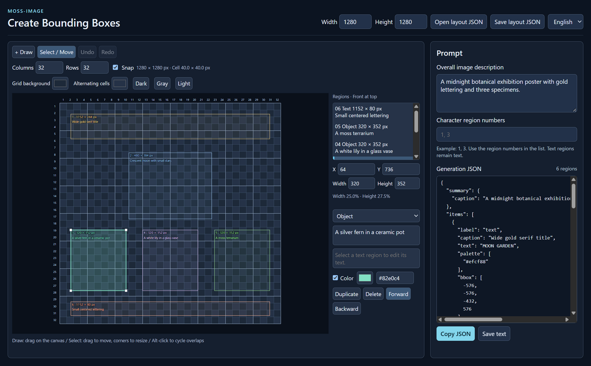

# MossImage Layout Editor

English | [日本語](README_ja.md)

A standalone Windows app for Create Bounding Boxes (MossImage), built with Tauri. Edit layouts and export JSON prompts for MOSS-Image without running ComfyUI.

Use [ComfyUI-MossImageTools](https://github.com/hybskgks28275/ComfyUI-MossImageTools) to edit the same layout JSON inside a ComfyUI workflow.



## Install and launch on Windows

1. Open [GitHub Releases](https://github.com/hybskgks28275/MossImage-Layout-Editor/releases). Under **Assets**, download the Windows x64 app archive. The automatically generated **Source code** archives contain only the source files.
2. Extract the entire archive to a folder of your choice.
3. Open `MossImage Layout Editor.exe` from the extracted folder. Keep the executable and the other extracted files together.

The app runs without an installer and uses Microsoft Edge WebView2 Runtime, which is usually already installed on Windows 10 and 11. If it is missing, install it from [Microsoft](https://developer.microsoft.com/microsoft-edge/webview2/). To bring an existing Electron draft into Tauri, save it as a layout JSON in the old app and open it in the new app.

## Edit layouts and export prompts

1. Set the output image width and height at the top, then choose **+ Draw** to add regions.
2. Enter an overall image description in the right panel. To label object regions as characters, enter their region numbers.
3. Select **Copy JSON** or **Save text** to export the generation prompt. The preview is formatted for readability. Both export options produce single-line JSON.

Use **Open layout JSON** and **Save layout JSON** to exchange editable version 1 layouts with the ComfyUI custom node. Set the same canvas width and height in ComfyUI before importing a layout. The desktop app saves the dimensions, overall description, and character region numbers in the layout file. In ComfyUI, enter these values in the corresponding nodes. When opening an older layout without dimensions in the desktop app, the editor starts from the current canvas size and expands it as needed to fit all regions. If you know the original image size, check and adjust the dimensions after import.

## Development

Use Node.js 24, a stable Windows x64 MSVC Rust toolchain, and the Microsoft C++ Build Tools. See the [Tauri prerequisites](https://v2.tauri.app/start/prerequisites/).

```powershell
npm start
npm test
npm run package:win
```

The packaging command creates a ready-to-upload ZIP in `dist/` with the Windows executable, both READMEs, the screenshots, and the license.

The `src/editor/` directory bundles the ComfyUI-MossImageTools editor under the [MIT License](LICENSE).
