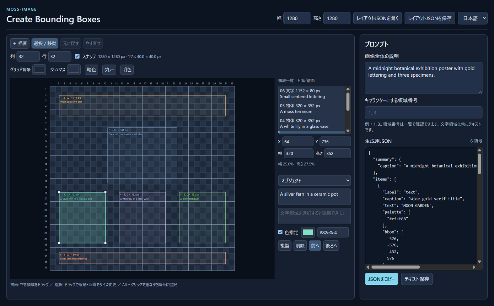

# MossImage Layout Editor

[English](README.md) | 日本語

Tauriで作成した、Create Bounding Boxes (MossImage) のWindows向けスタンドアローンアプリです。ComfyUIを起動せずにレイアウトを編集し、MOSS-Imageの生成用プロンプトをJSONで出力できます。

ComfyUIのワークフロー内で同じレイアウトJSONを編集するには、[ComfyUI-MossImageTools](https://github.com/hybskgks28275/ComfyUI-MossImageTools/blob/main/README_ja.md)を使ってください。



## Windowsでのインストールと起動

1. [GitHub Releases](https://github.com/hybskgks28275/MossImage-Layout-Editor/releases)を開き、**Assets** から Windows x64 版のアプリアーカイブをダウンロードします。自動生成される **Source code** のアーカイブにはソースファイルだけが含まれます。
2. アーカイブ全体を任意のフォルダに展開します。
3. 展開先の `MossImage Layout Editor.exe` を起動します。実行ファイルと一緒に展開されたファイルは、同じフォルダにまとめて置いてください。

インストーラー不要で、Microsoft Edge WebView2 Runtimeを使います。通常はWindows 10・11に入っています。未導入の場合は [Microsoftの配布ページ](https://developer.microsoft.com/microsoft-edge/webview2/)からインストールしてください。Electron版の編集中の内容を引き継ぐには、旧版でレイアウトJSONを保存し、新版で開いてください。

## レイアウトの編集とプロンプトの出力

1. 上部で生成画像の幅と高さを設定し、「＋ 描画」で領域を作ります。
2. 右側で画像全体の説明と、必要ならキャラクターとして扱う領域番号を入力します。
3. 「JSONをコピー」または「テキスト保存」で生成用プロンプトを取り出します。画面では読みやすく整形し、コピー・保存時は1行のJSONにします。

「レイアウトJSONを開く」と「レイアウトJSONを保存」は編集データ用です。アプリとComfyUIのカスタムノードの間で、version 1のレイアウトJSONを相互に読み込めます。ComfyUIで開く前に、キャンバスの幅と高さをアプリと同じ値に設定してください。アプリが保存した幅・高さ・全体説明・キャラクター番号は、ComfyUIでは対応するノードに入力します。幅と高さを含まない旧形式をアプリで開くと、現在の寸法を基準に、全領域が収まるよう必要に応じてキャンバスを広げます。元の生成サイズが分かる場合は、読み込み後に寸法を確認・調整してください。

## 開発

Node.js 24、Windows x64 MSVC向けの安定版Rust、Microsoft C++ Build Toolsを使用します。[Tauriの開発環境要件](https://v2.tauri.app/start/prerequisites/)を参照してください。

```powershell
npm start
npm test
npm run package:win
```

配布用ZIPは `dist/` に作成されます。Windows実行ファイル、英語と日本語のREADME、画面キャプチャ、ライセンスを同梱しており、そのままGitHub Releasesに添付できます。

`src/editor/` には ComfyUI-MossImageTools のエディターを同梱しています。[MITライセンス](LICENSE)が適用されます。
